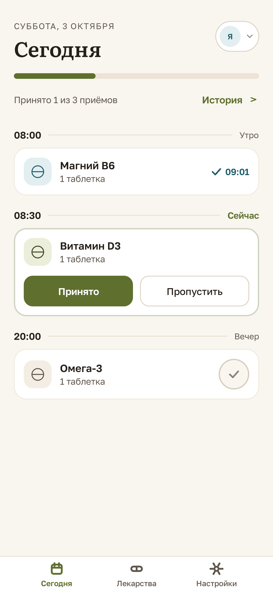
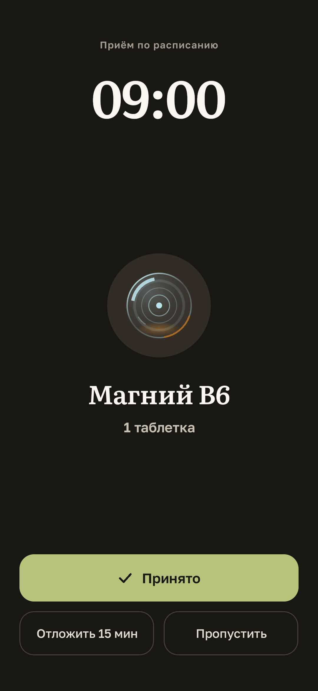
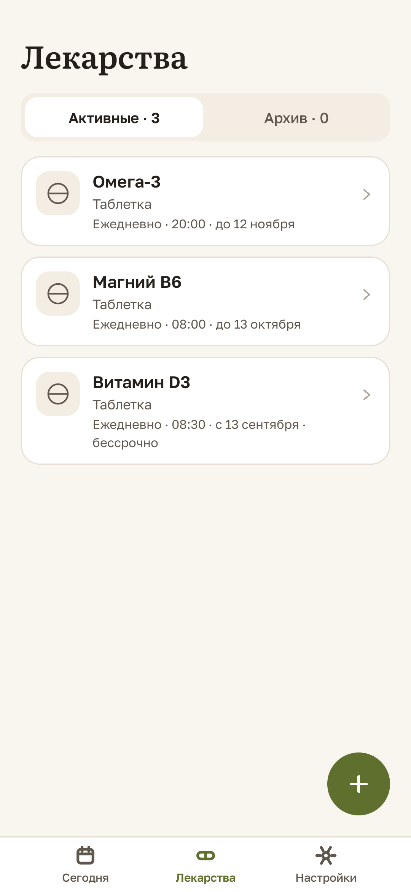
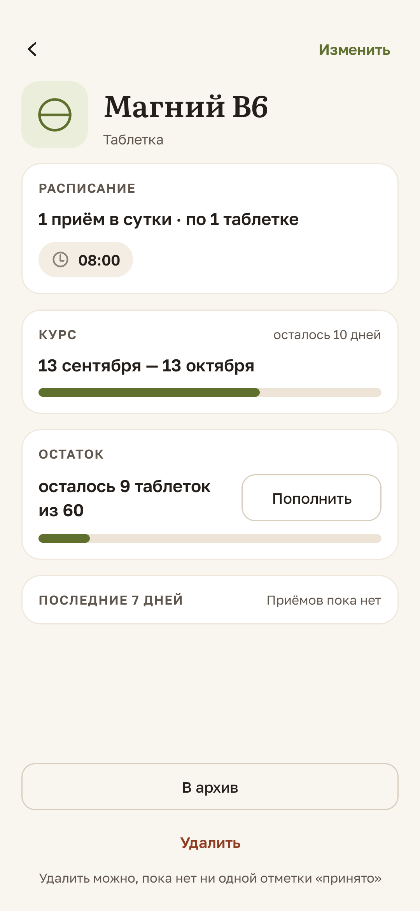
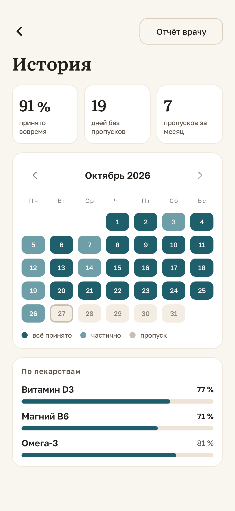
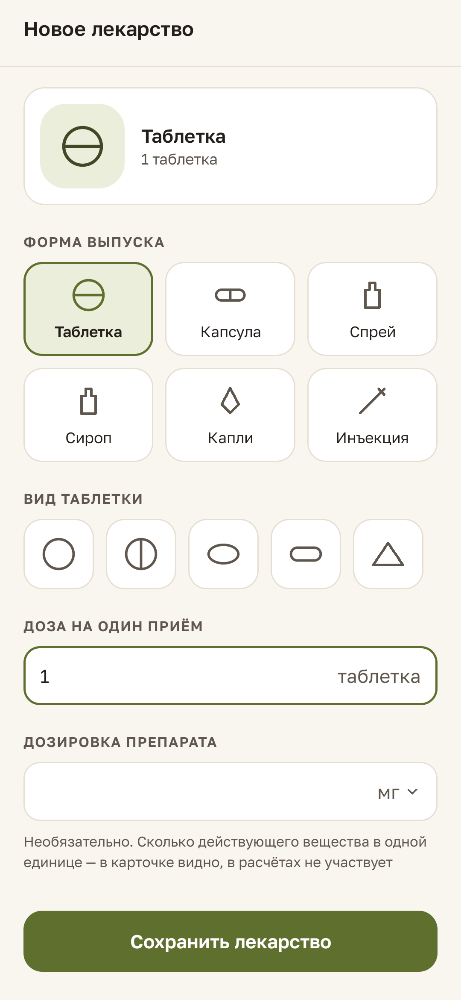

# Sklyanka

Sklyanka is a medication tracker for Android. You enter a course — schedule, dose, the relation
to meals, the package stock — and the app reminds you at the scheduled minute, takes a one-tap
mark and keeps a history you can show to your doctor as a PDF report.

The interface is Russian, with English, Spanish, German, Chinese and Kazakh translations.
The product is free in full: there is no paid tier, no subscription and no purchase.

Sklyanka is not a medical device: it does not give treatment recommendations, does not select
dosages and does not check drug interactions.

<p>
  
  
  
  
  <br>
  
  
</p>

## What it does

- **Reliable local reminders.** The app walks the person through the permission steps of the
  device vendor, so a reminder arrives at the scheduled minute and survives a restart, Doze,
  a time-zone change and the battery optimisation of the firmware.
- **Schedules.** Times of day, weekly schemes, interval and cyclic courses, an open-ended
  course, a course period, a dose, a relation to meals and an "as needed" mode.
- **Marks.** One tap to mark an intake as taken, a short window to undo it, a deliberate skip,
  and a "missed" state that appears by itself when the day is over.
- **Package stock** with a refill warning before the package runs out.
- **History and adherence** by day, week and month, with a calendar, and a **PDF report for the
  doctor** plus CSV export.
- **Profiles** — up to five, so one person can track a dependant's intakes without mixing them
  up with their own.
- **Widgets** — three of them, on the home screen.
- **Moving to another device** with a single file that the person creates and keeps.
- **A reminder self-check** that tests delivery through the real path and shows the result.

## Privacy

Privacy is a property of the product, not a setting. Health data — medications, schedules,
marks, profiles — is stored only on the device, in the app's private storage. There is no
account, no cloud and no sync.

The build in this repository declares the `INTERNET` permission for a single contour: client
analytics that runs only after an explicit consent and sends no medical data — no medication
names, doses, marks or profile names. Ads, data sale and transfer of health data to third
parties are out of scope for the product. See [`docs/spec/privacy.md`](docs/spec/privacy.md).

## Platform

| Item | Value |
|---|---|
| Minimum Android | 8.0 (API 26) |
| Language of the interface | Russian, English, Spanish, German, Chinese, Kazakh |
| Google services | not used: no GMS, no Firebase |
| Storage | Room, on device |
| Time | exact alarms through `AlarmManager` |

## Project structure

The repository is a multi-module Gradle project. The domain does not depend on Android, and the
UI reads design tokens only from `core-ui`.

| Module | Responsibility |
|---|---|
| `core-domain` | domain model and rules: schedules, marks, stock, profiles, transfer, adherence |
| `core-data` | Room database, repositories, migrations, transfer file codec |
| `core-ui` | design system: tokens, typography, components, theme |
| `core-analytics` | consent-gated client analytics contour |
| `feature-today` | the Today screen |
| `feature-meds` | medications list and the medication form |
| `feature-reminder` | reminders, full-screen reminder, deferral |
| `feature-history` | history, adherence and the report |
| `feature-settings` | settings |
| `feature-onboarding` | first launch, permission setup and reliability onboarding |
| `feature-widgets` | home-screen widgets |
| `feature-pro`, `billing-appgallery` | the paid contour, kept behind a build flag and not shipped |
| `app` | application module: navigation, DI, platform wiring |
| `acceptance` | scenario acceptance tests and the shared step vocabulary |
| `build-logic` | Gradle convention plugins and the project checks |

Architecture decisions are recorded in [`docs/adr/`](docs/adr/); the module map and the data flow
are in [`docs/spec/architecture.md`](docs/spec/architecture.md).

## Build and test

Requirements: JDK 17 and the Android SDK with API 35.

```bash
./gradlew :app:assembleFreeDebug      # debug build of the shipped variant
./gradlew verifyAll                   # the full gate: build, static analysis, all JVM tests
```

`verifyAll` runs the build of every module, detekt with the project's own rules, ktlint, Android
Lint, the artifact composition checks, all JVM test levels (unit and the Robolectric screen
stand) and the Gherkin acceptance scenarios.

Some checks need more than a JVM:

```bash
./gradlew :core-data:connectedDebugAndroidTest   # Room, DAOs and migrations on a device
./gradlew :acceptance:acceptanceChecklist        # the manual device check-list
tools/emulator/run-all.sh                        # the emulator matrix: API 26, 31, 35
```

The acceptance scenarios live in `acceptance/src/main/resources/features/`, one file per area.
They are written in Russian, the language of the interface and of the data they assert, and
their step definitions are Kotlin; the scenario text and the step pattern have to match
exactly, which the `verifyAcceptanceSteps` task checks on every run.

## Documentation

| Document | Content |
|---|---|
| [`docs/spec/product.md`](docs/spec/product.md) | what the product is, who it serves, goals, principles, composition |
| [`docs/spec/behavior.md`](docs/spec/behavior.md) | data and invariants, schedule and intake, reminders, permissions, screens, profiles, transfer |
| [`docs/spec/design-system.md`](docs/spec/design-system.md) | tokens, colour, typography, geometry, components, accessibility |
| [`docs/spec/design-screens.md`](docs/spec/design-screens.md) | screen header, scrolling, motion, dark environment, layout localization |
| [`docs/spec/quality.md`](docs/spec/quality.md) | verification levels, build gates, quality requirements |
| [`docs/spec/architecture.md`](docs/spec/architecture.md) | the stack and the module map |
| [`docs/spec/glossary.md`](docs/spec/glossary.md) | domain terms and value codes |
| [`docs/spec/privacy.md`](docs/spec/privacy.md) | what the app does with information |
| [`docs/adr/`](docs/adr/) | architecture decision records |

The original customer specification and the screen mockups are kept untouched in
[`design/`](design/); they are Russian, as the product was specified in Russian.

## Contributing

The product's first rule is that a missed reminder is a product failure, not a convenience
defect. Profiles never mix, and accounting works without a network. If you change behaviour,
change the scenario in `acceptance/src/main/resources/features/` first: the scenarios are the
contract, and a scenario that passes while the behaviour is wrong is a defect.

See [`AGENTS.md`](AGENTS.md) for the conventions of the repository and
[`CONTRIBUTING.md`](CONTRIBUTING.md) for the workflow.

## License

Apache License 2.0. See [`LICENSE`](LICENSE) and [`NOTICE`](NOTICE).

The app is not a medical device and nothing in this repository is medical advice.
