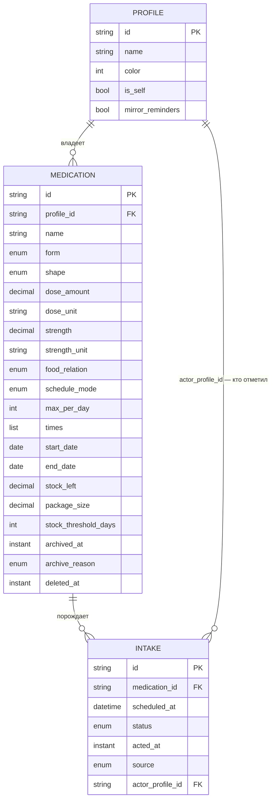
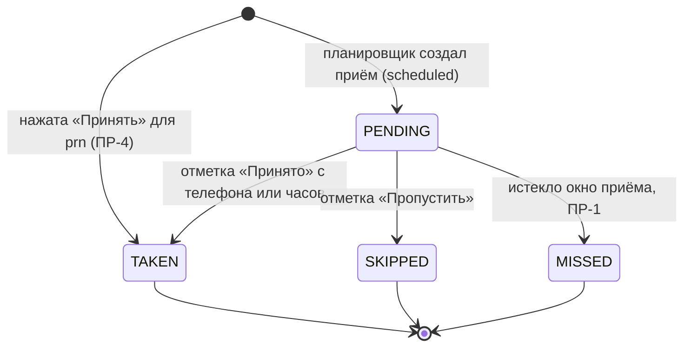

# Модель данных

Источник требований — `design/SPEC-original.md` §3, §7, §8. Имена в коде согласованы с
`docs/spec/11-glossary.md`.

Три сущности: **Profile** (кому), **Medication** (что и когда), **Intake** (что произошло с
конкретным приёмом). Всё остальное — производное и не хранится: приверженность считается из
`Intake`, остаток пересчитывается при отметке, «курс» — это пара дат внутри `Medication`.

## 1. Связи сущностей

Словами: **Profile 1 — N Medication 1 — N Intake**. Профиль приёма определяется однозначно
через лекарство (`Intake → Medication → Profile`); отдельного поля профиля в `Intake` нет.
Поле `actor_profile_id` — это не владелец приёма, а тот, кто поставил отметку
(`design/SPEC-original.md` §3).

## 2. Profile

Профиль — владелец набора лекарств. Смешивание профилей запрещено: интерфейс всегда работает
в контексте одного активного профиля (`design/SPEC-original.md` §3, §7).

| Поле | Тип | Обязательность | Значение по умолчанию | Смысл и ограничения |
|---|---|---|---|---|
| `id` | `String` (UUID) | обязательное | генерируется при создании | Первичный ключ. Тип выбран ради переноса данных: при слиянии двух файлов (`design/SPEC-original.md` §8) автоинкрементные числа сталкиваются, UUID — нет. **Предложение исполнителя**, спека тип не задаёт |
| `name` | `String` | обязательное | — | Имя профиля. Показывается в надписи «Профиль · Имя» над заголовком (`design/SPEC-original.md` §7). Непустое после обрезки пробелов |
| `color` | `Int` (ARGB) | обязательное | назначается при создании из палитры | Цвет профиля. Используется в полосе вверху экрана, подкрашенной шапке и как акцентный цвет действий для чужого профиля. Для чужого профиля спека задаёт `#8F3E23` (`design/SPEC-original.md` §9) |
| `is_self` | `Boolean` | обязательное | `false` | Профиль владельца приложения. Ровно один профиль в базе имеет `true` (ИНВ-1). Определяет, считается ли профиль «чужим» и нужна ли избыточная индикация |
| `mirror_reminders` | `Boolean` | обязательное | **Не зафиксировано — `ОВ-152`** | Дублировать ли напоминания профиля на устройство владельца приложения. Для профиля с `is_self = true` значение смысла не имеет и игнорируется (ИНВ-2) |

> **Открытый вопрос (`ОВ-152`).** Значение `mirror_reminders` по умолчанию при создании
> профиля не зафиксировано. Варианты: включено по умолчанию (присмотр работает сразу, но
> владелец получает лишние напоминания) или выключено (тише, но сценарий Б не работает, пока
> человек не догадается включить). *(Ревизия 07.10.2026: вторая половина прежнего вопроса —
> сам экран добавления профиля с этим выбором, названный открытым в
> `design/SPEC-original.md` §12, — закрыта решением `ОВ-3`: мастер добавления профиля
> с объяснением дублирования. В первой публикации экрана нет: строка «Добавить профиль»
> выключена (SKL-58).)*

> **Решено (ОВ-7, SKL-36).** Удаление профиля разрешено и выполняется каскадом: приёмы,
> лекарства и сам профиль стираются одной транзакцией. Профиль `is_self` не удаляется
> (ПРФ-28). Удаление — осознанное действие с предупреждением, числами потерь
> и предложением выгрузить файл переноса (`docs/spec/06-profiles.md` §6, SKL-36);
> будильники снимаются немедленно (ПРФ-30). Обоснование выбора — `design-decisions.md`,
> «ОВ-7 · Удаление профиля — уточнение по SKL-36».

## 3. Medication

Лекарство вместе с его курсом и расписанием (`design/SPEC-original.md` §3).

| Поле | Тип | Обязательность | Значение по умолчанию | Смысл и ограничения |
|---|---|---|---|---|
| `id` | `String` (UUID) | обязательное | генерируется | Первичный ключ, см. обоснование в Profile |
| `profile_id` | `String` | обязательное | активный профиль на момент создания | Внешний ключ на `Profile.id`. Неизменяем после создания: перенос лекарства между профилями исказил бы историю (ИНВ-3) |
| `name` | `String` | обязательное | — | Название, введённое человеком. Приложение не сверяет его со справочником (НЦ-1). Непустое после обрезки пробелов |
| `form` | `MedicationForm` | обязательное | «таблетка» (`MedicationForm.TABLET`) | Форма выпуска: таблетка, капсула, спрей, сироп, капли, инъекция. Определяет, применимо ли поле `shape` (ПР-9). *(Ревизия 07.10.2026: прежнее «Решение не зафиксировано» заменено фактом реализации — форма нового лекарства открывается с выбранной таблеткой, `core-domain/src/main/kotlin/ru/stohastika/sklyanka/domain/medication/MedicationDraft.kt:37`.)* |
| `shape` | `TabletShape?` | условно-обязательное | `null` | Вид таблетки: круглая, круглая с риской, овальная, продолговатая, треугольная. Заполняется **только** для формы «таблетка» (ПР-9, ОВ-88). Служит визуальному узнаванию в списке, на смысл приёма не влияет |
| `dose_amount` | `BigDecimal` | обязательное | значения нет — поле пустое | Доза на один приём — сколько единиц принимается за раз (например, 1.5 таблетки). Строго больше нуля (ИНВ-4). Списывается из остатка при отметке `taken` (ПР-5). *(Ревизия 07.10.2026: прежнее «Решение не зафиксировано» заменено фактом реализации — число не подставляется, `MedicationDraft.doseAmount = null`; сохранение без дозы невозможно по ИНВ-4, поэтому «значение по умолчанию» здесь означало бы молчаливую дозу.)* |
| `dose_unit` | `String` | обязательное | производное от `form` | Единица дозы: «таблетка», «мл», «капля», «доза». Отображается рядом с `dose_amount` |
| `strength` | `BigDecimal?` | необязательное | `null` | Дозировка самого препарата (например, 500). Отличается от `dose_amount`: одно дело «две таблетки», другое — «по 500 мг». Приложение значением не пользуется, только показывает |
| `strength_unit` | `String?` | необязательное | `null` | Единица дозировки: «мг», «мкг», «мг/мл». Заполняется вместе со `strength` (ИНВ-5) |
| `food_relation` | `FoodRelation` | обязательное | `ANY` («неважно») | Связь с едой: неважно, до еды, во время, после еды. Показывается в карточке и в напоминании; на расчёт времени не влияет |
| `schedule_mode` | `ScheduleMode` | обязательное | `SCHEDULED` | Режим: по расписанию или по потребности. Определяет применимость `times[]` и `max_per_day` (ПР-7, ПР-8) и способ появления записей `Intake` (ПР-4) |
| `max_per_day` | `Int?` | условно-обязательное | `null` | Максимум приёмов в сутки. Заполняется **только** при `schedule_mode = PRN` (ПР-7). Больше нуля, если задано |
| `times[]` | `List<LocalTime>` | условно-обязательное | пустой список | Время каждого приёма в течение суток. Заполняется **только** при `schedule_mode = SCHEDULED` (ПР-8), и тогда непустой список без повторов (ИНВ-6). Хранится как локальное время без часового пояса, см. §8 |
| `start_date` | `LocalDate` | обязательное | сегодняшняя дата | Первый день курса. Приёмы раньше этой даты не порождаются |
| `end_date` | `LocalDate?` | необязательное | `null` | Последний день курса включительно. **Пустое значение означает бессрочный приём** (ПР-6). Если задано — не раньше `start_date` (ИНВ-7) |
| `stock_left` | `BigDecimal?` | необязательное | `null` | Остаток упаковки в тех же единицах, что и `dose_amount`. `null` означает «человек остаток не ведёт» — предупреждение о покупке не показывается. Не опускается ниже нуля (ИНВ-8) |
| `package_size` | `BigDecimal?` | необязательное | `null` | Размер упаковки в тех же единицах, что и `dose_amount` (ОВ-45). `null` означает «размер не задан»: карточка показывает «осталось N» без полосы, из остатка значение не подставляется. Строго больше нуля, если задан (ИНВ-20). Свойство упаковки: пополнение остатка его не меняет |
| `stock_threshold_days` | `Int?` | необязательное | `null` | Порог напоминания о покупке: на сколько дней осталось запаса, прежде чем показать предупреждение. Имеет смысл только вместе с `stock_left` |
| `archived_at` | `Instant?` | необязательное | `null` | Момент отправки в архив: курс снят с расписания, но остаётся в истории и в экране «Архив» (ПР-11). `null` означает активный курс |
| `archive_reason` | `ArchiveReason?` | условно-обязательное | `null` | Причина архивации: `course_finished` или `manual`. Задаёт раздел в экране «Архив» (`design/SPEC-original.md` §4). Заполняется тогда и только тогда, когда заполнено `archived_at` (ИНВ-9) |
| `deleted_at` | `Instant?` | необязательное | `null` | **Мягкое удаление** (ПМ-24, ПР-14): момент удаления ошибочно заведённого лекарства. `null` — лекарство не удалено. Удалённое лекарство не показывается ни на одном экране (включая «Архив»), не порождает приёмов, не участвует в истории, приверженности, отчёте врачу и предупреждениях об остатке; строки `Intake` сохраняются. Не заполняется, если заполнено `archived_at`, и наоборот (ИНВ-21). Удалить можно только лекарство без единой отметки `TAKEN` (ПР-14, ИНВ-22) |

> **Решено (ОВ-16).** Единицы — закрытый список: единица дозы производна от формы выпуска
> (`DoseUnit`: таблетка, капсула, мл, доза; капли считаются миллилитрами, инъекции — дозами),
> единицы дозировки — мг, мкг, г, мл, МЕ, %. Приложение не оценивает название и дозу,
> а только хранит и показывает введённое (П-4).

> **Решено (ОВ-39).** Для `schedule_mode = PRN` «хватит на N дней» не показывается:
> суточный расход по потребности неизвестен, а выдуманное число — ложная оценка.
> Для расписания суточный расход выводится из `times[]`.

> **Решено (ОВ-42).** `archive_reason = course_finished` автоматически не ставится:
> при наступлении `end_date` приложение **предлагает** убрать курс в архив, человек
> подтверждает (`CourseCompletion`). Причина `manual` ставится при архивации из карточки.
> Молчаливой архивации не происходит.

## 4. Intake

Одна запись на каждый запланированный приём (`design/SPEC-original.md` §3). Для приёма по
потребности запись появляется в момент нажатия «Принять» (ПР-4).

| Поле | Тип | Обязательность | Значение по умолчанию | Смысл и ограничения |
|---|---|---|---|---|
| `id` | `String` (UUID) | обязательное | генерируется | Первичный ключ. Служит ключом идемпотентности отметки (ПР-2): отметка с телефона и с часов адресуется одним и тем же `intake_id` |
| `medication_id` | `String` | обязательное | — | Внешний ключ на `Medication.id`. Неизменяем. Через него определяется профиль приёма |
| `scheduled_at` | `LocalDateTime` | обязательное | — | Назначенное время приёма. Для `PRN` равно `acted_at` (ПР-4). Хранение локального времени обосновано в §8 |
| `status` | `IntakeStatus` | обязательное | `PENDING` | `pending`, `taken`, `skipped`, `missed`. Жизненный цикл — §6 |
| `acted_at` | `Instant?` | условно-обязательное | `null` | Фактический момент отметки. `null` при `PENDING`; заполнено при любом другом статусе (ИНВ-10). Разрешает гонку часов и телефона (ПР-3) |
| `source` | `IntakeSource?` | условно-обязательное | `null` | Откуда пришла отметка: `phone`, `watch`, `auto`. `auto` — автоматический перевод в `missed` (ПР-1). Заполняется вместе с `acted_at` (ИНВ-10) |
| `actor_profile_id` | `String?` | необязательное | `null` | Кто отметил, если профиль чужой. Заполняется, когда отметку поставил не владелец профиля лекарства (ПР-12). Основание для подписи «отметили вы» в истории (`design/SPEC-original.md` §7) |

## 5. Перечисления

Значения перечислений хранятся в базе строковыми константами, а не порядковыми номерами:
порядковый номер ломается при вставке нового значения и нечитаем в файле переноса данных
(`design/SPEC-original.md` §8).

### MedicationForm — форма выпуска (`form`)

| Значение в коде | По-русски |
|---|---|
| `TABLET` | таблетка |
| `CAPSULE` | капсула |
| `SPRAY` | спрей |
| `SYRUP` | сироп |
| `DROPS` | капли |
| `INJECTION` | инъекция |

### TabletShape — вид таблетки (`shape`)

Применимо только к `TABLET` (ПР-9, ОВ-88). У капсулы вида нет: её силуэт задан самой формой,
подходящих вариантов среди пяти не существует («круглой капсулы» не бывает).

> **Записи, созданные до сужения.** Лекарства-капсулы, сохранённые до решения ОВ-88,
> могли иметь непустой `shape`. Значение не удаляется: чистящая миграция `shape = NULL`
> для `form != 'TABLET'` не делается (расхождение косметическое — вид на приём не влияет,
> а миграция данных несёт риск; см. `docs/tasks/SKL-66/TDD.md` §4). Такие значения
> игнорируются отображением (подпись карточки, силуэт) и перестают появляться при первом же
> сохранении лекарства формой.

| Значение в коде | По-русски |
|---|---|
| `ROUND` | круглая |
| `ROUND_SCORED` | круглая с риской |
| `OVAL` | овальная |
| `OBLONG` | продолговатая |
| `TRIANGULAR` | треугольная |

### FoodRelation — связь с едой (`food_relation`)

| Значение в коде | По-русски |
|---|---|
| `ANY` | неважно |
| `BEFORE_MEAL` | до еды |
| `WITH_MEAL` | во время еды |
| `AFTER_MEAL` | после еды |

### ScheduleMode — режим приёма (`schedule_mode`)

| Значение в коде | По-русски | Следствия |
|---|---|---|
| `SCHEDULED` | по расписанию | Требует `times[]`, запрещает `max_per_day`. Записи `Intake` порождаются планировщиком заранее |
| `PRN` | по потребности | Требует запрета `times[]`, допускает `max_per_day`. Запись `Intake` создаётся в момент нажатия «Принять» (ПР-4) |

### IntakeStatus — состояние приёма (`status`)

| Значение в коде | По-русски | Смысл |
|---|---|---|
| `PENDING` | ожидается | Время не настало либо окно ещё не истекло, отметки нет |
| `TAKEN` | принято | Человек подтвердил приём |
| `SKIPPED` | пропущено осознанно | Человек явно отказался от приёма |
| `MISSED` | пропущено без отметки | Окно истекло, отметки не было; проставляется автоматически (ПР-1) |

Различие `SKIPPED` и `MISSED` содержательно: первое — решение человека, второе — отсутствие
решения. В отчёте врачу они не смешиваются.

### IntakeSource — источник отметки (`source`)

| Значение в коде | По-русски |
|---|---|
| `PHONE` | отмечено в телефоне |
| `WATCH` | отмечено на часах |
| `AUTO` | проставлено приложением автоматически |

### ArchiveReason — причина архивации (`archive_reason`)

| Значение в коде | По-русски |
|---|---|
| `COURSE_FINISHED` | курс завершён |
| `MANUAL` | убрано вручную |

## 6. Жизненный цикл Intake

### Условия переходов

| Переход | Условие | Побочные эффекты |
|---|---|---|
| `PENDING → TAKEN` | Человек нажал «Принять» в телефоне, в напоминании или на карточке часов | `acted_at` = момент нажатия, `source` = `PHONE`/`WATCH`, `actor_profile_id` по ПР-12; `stock_left` уменьшается на `dose_amount` (ПР-5) |
| `PENDING → SKIPPED` | Человек нажал «Пропустить» | `acted_at`, `source`, `actor_profile_id` заполняются так же. Остаток **не** трогается |
| `PENDING → MISSED` | Истекло окно приёма без отметки (ПР-1) | `acted_at` = момент перевода, `source` = `AUTO`, `actor_profile_id` остаётся `null`. Остаток не трогается |
| `— → TAKEN` (создание) | Нажата «Принять» для лекарства с `schedule_mode = PRN` | Запись создаётся сразу в статусе `TAKEN`, `scheduled_at = acted_at` (ПР-4), остаток уменьшается (ПР-5) |

### Необратимость

Из `TAKEN`, `SKIPPED` и `MISSED` в модели нет исходящих переходов: **новое решение человека
не может переписать уже поставленный статус**. Это прямое следствие идемпотентности отметки
(ПР-2) — повторная отметка того же `intake_id` запись не меняет.

Необратимость запрещает пересмотр, а не уточнение факта. Замещение более ранним нажатием
(ПР-3) ей не противоречит и является единственным исключением: запись о приёме может быть
переписана отметкой, у которой `acted_at` раньше уже записанного. Это не новое решение,
а то же самое нажатие, дошедшее позже — обычный случай для часов, где нажатие и его доставка
на телефон разнесены во времени. Замещение не списывает дозу второй раз.

Формулировка «статус ставится один раз» без этой оговорки прямо противоречила бы ПР-3
и сценарию гонки «часы против телефона»: телефон записался в 08:05, нажатие с часов
в 08:03 дошло в 08:06 и обязано победить.

> **Решено (ОВ-6).** Отмена ошибочной отметки — в **коротком окне 4–6 секунд**: после
> «Принято»/«Пропустить» показывается снэкбар «Отменить», отмена возвращает приём
> в `PENDING` и возвращает списанную дозу (`StockEffect.RESTORE`), пишет след в журнал
> (`UndoMarkUseCase`, SKL-30). Задним числом история не правится: длинного окна
> и изменения статусов из карточки приёма или истории нет. Поздняя отмена заменяется
> новым решением — отметкой, а не переписыванием записи (ПР-2, ПР-3).

## 7. Правила предметной области

Правила ПР-1 … ПР-14 выведены из `design/SPEC-original.md` §3, если не указано иное. На них
ссылаются задачи SKL-06 и SKL-07; ПР-14 добавлено решением ПМ-24.

| Код | Правило |
|---|---|
| **ПР-1** | `PENDING` автоматически превращается в `MISSED` по истечении окна приёма. По умолчанию окно — до конца суток. При переводе `source = AUTO`, `acted_at` = момент перевода |
| **ПР-2** | Отметка идемпотентна по `intake_id`: повторная отметка того же приёма не создаёт вторую запись и не меняет уже записанную |
| **ПР-3** | Гонка «часы против телефона» для одного приёма разрешается по первому `acted_at`: выигрывает более ранняя отметка, второй отметкой пренебрегаем. Сравнение идёт по `acted_at`, а не по времени доставки: сообщение с часов приходит позже, чем нажата кнопка |
| **ПР-4** | Для `schedule_mode = PRN` запись `Intake` создаётся в момент нажатия «Принять», и `scheduled_at` равен `acted_at`. Записей `PENDING` для `prn` не существует |
| **ПР-5** | Отметка `TAKEN` уменьшает `stock_left` лекарства на `dose_amount`. Отметки `SKIPPED` и `MISSED` остаток не трогают. Если `stock_left` равен `null`, правило не применяется |
| **ПР-6** | Пустой `end_date` означает бессрочный приём: планировщик порождает приёмы на очередное окно без конечной даты |
| **ПР-7** | `max_per_day` заполняется только при `schedule_mode = PRN`; для `SCHEDULED` он `null` |
| **ПР-8** | `times[]` заполняется только при `schedule_mode = SCHEDULED`; для `PRN` список пуст |
| **ПР-9** | `shape` заполняется только при `form = TABLET` (ОВ-88); для капсулы и остальных форм он `null` |
| **ПР-10** | Профиль приёма определяется через лекарство. Выборки экрана «Сегодня» и истории всегда ограничены активным профилем; запроса, возвращающего приёмы нескольких профилей одновременно, в приложении не существует (`design/SPEC-original.md` §7) |
| **ПР-11** | Архивированное лекарство (`archived_at` не `null`) не порождает новых приёмов и не участвует в планировании напоминаний. Уже существующие записи `Intake` сохраняются и остаются в истории |
| **ПР-12** | `actor_profile_id` заполняется, когда отметку поставил не владелец профиля лекарства, — то есть при работе в чужом профиле. Значение — `id` профиля с `is_self = true`. Это основание для подписи «отметили вы» в истории |
| **ПР-13** | Предупреждение об остатке показывается, когда заданы и `stock_left`, и `stock_threshold_days`, и остатка хватает менее чем на `stock_threshold_days` дней при текущем расписании (`design/SPEC-original.md` §4 — «предупреждение об остатке»). Для `PRN` суточный расход не определён — см. открытый вопрос в §3 |
| **ПР-14** | **Удаление лекарства — мягкое (ПМ-24).** Лекарство с непустым `deleted_at` не порождает новых приёмов и не участвует в планировании напоминаний, не показывается ни в списках, ни в «Архиве», ни в истории и отчёте врачу, ни в предупреждениях об остатке; его записи `Intake` сохраняются в базе и переносятся файлом, но исключаются из расчёта приверженности. Удалить можно только лекарство, у которого нет ни одной записи `Intake` со статусом `TAKEN` (ИНВ-22); иначе единственный путь — архив. Удаление снимает будущие ожидающиеся приёмы и отменяет будильники (НАП-11). Возврат — очистка `deleted_at` (в коротком окне отмены, ПМ-24) |

> **Решено (ОВ-4).** Окно `pending → missed` — **до конца суток приёма** (НАП-35): отметка
> принимается до 23:59 суток, на которые назначен приём; в 00:00 следующих суток неотмеченный
> приём переходит в `MISSED` автоматически (`source = AUTO`). Граница — параметр домена
> (`IntakeWindow`, `EndOfDayIntakeWindow`), а не константа перехода: пересмотр решения меняет
> одну реализацию. Цена принята: поздняя отметка попадает в «принято» без слова «вовремя».

> **Решено (ОВ-28, ОВ-14).** При изменении расписания будущие `PENDING` **пересоздаются**:
> человек видит новое расписание немедленно (`IntakePlanDiff`, `PlanReason.SCHEDULE_EDITED`).
> При архивации и мягком удалении будущие `PENDING` **снимаются**, уже наступившие не трогаются
> и переводятся в `MISSED` общим правилом (ПР-1); отмеченные записи не переписываются никогда
> (ПР-11, ПР-14). Будильники пересобираются событием из НАП-11.

## 8. Замечания по хранению

### Room

Хранилище — Room поверх SQLite (`CLAUDE.md`, ADR-0001). Сущности `Profile`, `Medication`,
`Intake` — три таблицы. `times[]` не выносится в отдельную таблицу: список времён — часть
описания лекарства, отдельно не запрашивается и не изменяется по одному элементу. Хранится
конвертером как строка отсортированных значений `HH:mm`.

### Время: локальное или UTC

Выбор нетривиален, потому что в модели живут два разных вида времени, и смена часового пояса
разводит их в стороны.

- **Назначенное время** — это намерение в терминах стенных часов: «утром в 8:00, после
  завтрака». Человек, прилетевший в другой часовой пояс, ждёт, что напоминание придёт в 8:00
  **по местному времени**, а не в 11:00, как было бы при хранении момента в UTC. То есть это
  не момент времени, а правило.
- **Фактическое время отметки** — это, наоборот, именно момент: он произошёл один раз, его
  нельзя пересчитать, и на нём строится разрешение гонки часов и телефона (ПР-3) и
  упорядочивание истории.

**Решено (`ADR-0013`, SKL-04).** Раскладка принята исполнителем и реализована
(ретроспективно зафиксирована 07.10.2026 в `docs/spec/adr/ADR-0013-time-storage.md`);
спека подтверждает её как нормативную:

| Поле | Тип хранения | Почему |
|---|---|---|
| `Medication.times[]` | Локальное время `HH:mm` без пояса | Правило, а не момент. При перелёте продолжает означать «8 утра» |
| `Medication.start_date`, `end_date` | Локальная дата без пояса | Границы курса — календарные, а не моментные |
| `Intake.scheduled_at` | Локальные дата и время (`LocalDateTime`), плюс момент срабатывания, вычисляемый при планировании будильника | Группировка по суткам на экране «Сегодня» и в истории должна оставаться устойчивой; в UTC приём 23:30 попадал бы в чужой день |
| `Intake.acted_at` | Момент в UTC (`epochMillis`) | Факт. Сравнение по ПР-3 обязано быть корректным даже если часы и телефон в разных поясах |

Следствие для напоминаний: момент срабатывания будильника **вычисляется** из локального
времени в текущем поясе устройства и пересчитывается при смене пояса, ровно как требует
`design/SPEC-original.md` §5 («перепланирование при смене часового пояса»).

> **Решено (ОВ-29).** По умолчанию приёмы остаются в «своём» поясе: назначенное время —
> правило местных стенных часов, и перелёт не переписывает уже созданные записи. Человеку
> предлагается пересчитать приёмы текущих суток под местное время, автоматически этого
> не происходит: медически интервалы не оцениваются (П-4). Смена пояса — событие
> перепланирования будильников (`RescheduleReason.TIMEZONE_CHANGED`).

### Индексы

| Индекс | Назначение |
|---|---|
| `Medication(profile_id, archived_at)` | Список активных лекарств профиля и экран «Архив» — основной запрос экранов «Лекарства» и «Сегодня» |
| Уникальный `Intake(medication_id, scheduled_at, schedule_slot)` | Механическая защита от повторной генерации одного и того же приёма при перепланировании (ИНВ-13) и история по лекарству за неделю (карточка лекарства). `schedule_slot` разделяет расписание и «по потребности» — см. ниже |
| `Intake(scheduled_at, status)` | Экран «Сегодня» (приёмы суток) и выборка просроченных `PENDING` для ПР-1 |
| `Intake(actor_profile_id)` | Индекс дочерней колонки внешнего ключа `actor_profile_id → Profile.id` (`onDelete = RESTRICT`); Room не открывает схему без индекса под FK |

*(Ревизия 07.10.2026: таблица приведена к фактическому набору индексов —
`core-data/src/main/kotlin/ru/stohastika/sklyanka/data/room/entity/IntakeEntity.kt:45-49`,
`MedicationEntity.kt:33`. Прежняя редакция перечисляла отдельно неуникальный
`Intake(medication_id, scheduled_at)` и уникальный тот же состав «при
`schedule_mode = SCHEDULED`»; в схеме таких двух индексов нет: уникальность держит
тройка с `schedule_slot`, частичный индекс SQLite не используется.)*

> **Решено (SKL-04, реализация).** Уникальность приёмов «по расписанию» держит уникальный
> индекс `Intake(medication_id, scheduled_at, schedule_slot)`, где `schedule_slot = "S"`
> у приёма по расписанию и `null` у приёма «по потребности»: два приёма по потребности
> в одну минуту остаются законными (ИНВ-13, ИНВ-14). Частичный индекс SQLite не используется —
> Room не знает о нём и отказался бы открыть базу при сверке схемы.

### Мягкое удаление

Лекарство не удаляется физически никогда. У него два мягких состояния, и они не
взаимозаменяемы:

- **архив** (`archived_at` + `archive_reason`, ПР-11) — след курса; лекарство видно
  в «Архиве», участвует в истории, отчёте врачу и приверженности, может быть возвращено;
- **удаление** (`deleted_at`, ПР-14, ПМ-24) — ошибочно заведённая запись; лекарство скрыто
  везде, включая «Архив», историю и отчёт; строки `Intake` остаются в базе и переносятся
  файлом, но не участвуют в расчётах. Удалить можно только лекарство без отметок «принято»
  (ИНВ-22); после первого принятого приёма путь один — архив.

Физического удаления лекарства в интерфейсе нет вовсе; точечная очистка возможна только
режимом «заменить всё» при загрузке файла переноса (`design/SPEC-original.md` §8).

Миграция: nullable-колонка `deleted_at` добавляется неразрушающим изменением схемы
(МГ-2, МГ-3); существующие записи получают `null` и остаются активными. Обратная операция —
очистка `deleted_at` тем же полем, без новых сущностей.

## 9. Инварианты

Утверждения, которые обязана держать база или доменный слой. Каждое проверяется отдельным
тестом в рамках SKL-04 и SKL-07.

| Код | Инвариант |
|---|---|
| **ИНВ-1** | В базе ровно один `Profile` с `is_self = true` — не ноль и не два |
| **ИНВ-2** | Для профиля с `is_self = true` значение `mirror_reminders` не влияет ни на одно решение приложения |
| **ИНВ-3** | `Medication.profile_id` не меняется после создания записи |
| **ИНВ-4** | `dose_amount > 0` |
| **ИНВ-5** | `strength` и `strength_unit` заполнены либо оба, либо ни одного |
| **ИНВ-6** | При `schedule_mode = SCHEDULED` список `times[]` непуст и не содержит повторов; при `PRN` он пуст |
| **ИНВ-7** | Если `end_date` задана, то `end_date >= start_date` |
| **ИНВ-8** | `stock_left >= 0`; списание по ПР-5 не уводит остаток ниже нуля |
| **ИНВ-9** | `archived_at` и `archive_reason` заполнены либо оба, либо ни одного |
| **ИНВ-10** | `acted_at` и `source` заполнены тогда и только тогда, когда `status != PENDING` |
| **ИНВ-11** | При `status = PENDING` поля `acted_at`, `source`, `actor_profile_id` равны `null` |
| **ИНВ-12** | У каждого `Intake` существует `Medication` с указанным `medication_id`, а у него — существующий `Profile` (ссылочная целостность, внешние ключи включены) |
| **ИНВ-13** | Для лекарства с `schedule_mode = SCHEDULED` не существует двух записей `Intake` с одинаковым `scheduled_at` |
| **ИНВ-14** | Для записи `Intake` лекарства с `schedule_mode = PRN` выполняется `scheduled_at == acted_at` и `status != PENDING` |
| **ИНВ-15** | `scheduled_at` записи `Intake` лежит в пределах курса: не раньше `start_date` и, если `end_date` задана, не позже конца дня `end_date` |
| **ИНВ-16** | `shape` не `null` только при `form = TABLET` (ОВ-88) |
| **ИНВ-17** | `max_per_day` не `null` только при `schedule_mode = PRN` и, если задан, больше нуля |
| **ИНВ-18** | `actor_profile_id`, если заполнен, ссылается на существующий профиль и не совпадает с `Medication.profile_id` этого приёма |
| **ИНВ-19** | Повторная отметка существующего `intake_id` не изменяет `status`, `acted_at`, `source` и не повторяет списание остатка (ПР-2, ПР-3, ПР-5) |
| **ИНВ-20** | `package_size > 0`, если задан; `null` означает «размер не задан» и не является ошибкой |
| **ИНВ-21** | `deleted_at` и `archived_at` не заполнены одновременно: удаление очищает поля архива (и наоборот, архивация удалённого лекарства не производится) |
| **ИНВ-22** | У лекарства с непустым `deleted_at` нет ни одной записи `Intake` со статусом `TAKEN` (ПР-14, ПМ-24): удаление не скрывает факт приёма |

## 10. Миграции и версионирование схемы

| Код | Требование |
|---|---|
| **МГ-1** | `exportSchema = true`; JSON-схемы Room лежат в репозитории и входят в ревью. Изменение схемы без нового файла схемы не принимается |
| **МГ-2** | Разрушающая миграция (`fallbackToDestructiveMigration`) запрещена во всех сборках, включая отладочные. История приёмов — то, ради чего человек пользуется приложением; потеря базы при обновлении равносильна потере продукта |
| **МГ-3** | На каждую миграцию пишется тест на реальной базе предыдущей версии (`MigrationTestHelper`): версия открывается, мигрируется, данные проверяются |
| **МГ-4** | Версия схемы базы и версия формата файла переноса данных — **разные** числа, живущие независимо. Файл `sklyanka-ГГГГ-ММ-ДД.json` (`design/SPEC-original.md` §8) несёт собственное поле версии формата |
| **МГ-5** | Загрузка файла переноса, созданного более новой версией приложения, отклоняется с понятным сообщением, а не читается частично |
| **МГ-6** | Добавление значения в перечисление — это изменение, требующее решения о том, как его прочтут старые сборки при загрузке файла. Неизвестное значение перечисления при загрузке не роняет приложение |

Первая версия схемы фиксируется на SKL-04 вместе с профилями, даже пока интерфейса к
профилям нет (`PLAN.md`, этап 2): добавить профили в схему позже дороже, чем сразу.

> **Решено (ПЕР-9, ОВ-18, SKL-19).** При слиянии идентификаторы принимающей стороны
> не переиспользуются: записи файла получают новые `id`, исходные служат только связями
> внутри файла. Поэтому тип `String` (UUID) и выбран (§2), а повторная загрузка того же
> файла не сталкивает ключи. Совпадения лекарств определяются по нормализованному названию
> и дозировке (ПЕР-20) и разрешаются человеком поштучно (ПЕР-21).

## 11. Открытые вопросы этого документа

1. Значение `mirror_reminders` по умолчанию при создании профиля
   (`design/SPEC-original.md` §12) — **открыт** (ПРФ-9).
2. Удаление профиля: разрешено ли и что происходит с его лекарствами и историей —
   **решено (ОВ-7, SKL-36): каскадное удаление чужого профиля; `is_self` не удаляется.**
3. `dose_unit` и `strength_unit` — свободный текст или закрытый список —
   **решено (ОВ-16): закрытый список, единица дозы производна от формы (`DoseUnit`).**
4. Расчёт «на сколько дней хватит остатка» для `schedule_mode = PRN` (ПР-13) —
   **решено (ОВ-39): для «по потребности» предупреждение не показывается.**
5. Кто и когда проставляет `archive_reason = course_finished` —
   **решено (ОВ-42): приложение предлагает, человек подтверждает.**
6. Исправление ошибочной отметки — **решено (ОВ-6, SKL-30): отмена в коротком окне
   4–6 секунд; история задним числом не правится.**
7. Точная граница окна `pending → missed` в ПР-1 — **решено (ОВ-4, НАП-35):
   до конца суток приёма.**
8. Судьба существующих записей `PENDING` при изменении расписания или архивации —
   **решено (ОВ-28, ОВ-14): правка расписания пересоздаёт будущие `PENDING`;
   архивация и удаление снимают их.**
9. Поведение приёмов текущих суток при смене часового пояса (§8) —
   **решено (ОВ-29): по умолчанию остаются в своём поясе, пересчёт предлагается.**
10. Способ выражения уникальности `Intake(medication_id, scheduled_at)` только для
    `SCHEDULED` — **решено (SKL-04): уникальный индекс по тройке с `schedule_slot`.**
11. Существует ли окончательное удаление лекарства вместе с историей —
    **решено (ПМ-24, ОВ-122): физического удаления нет; ошибочно заведённое лекарство
    удаляется мягко (`deleted_at`) до первой отметки «принято», позже — только архив.**
12. Сопоставление записей по идентификаторам при слиянии файла переноса данных —
    **решено (ПЕР-9, ОВ-18): исходные `id` служат связями внутри файла, на приёмнике
    записи получают новые.**
