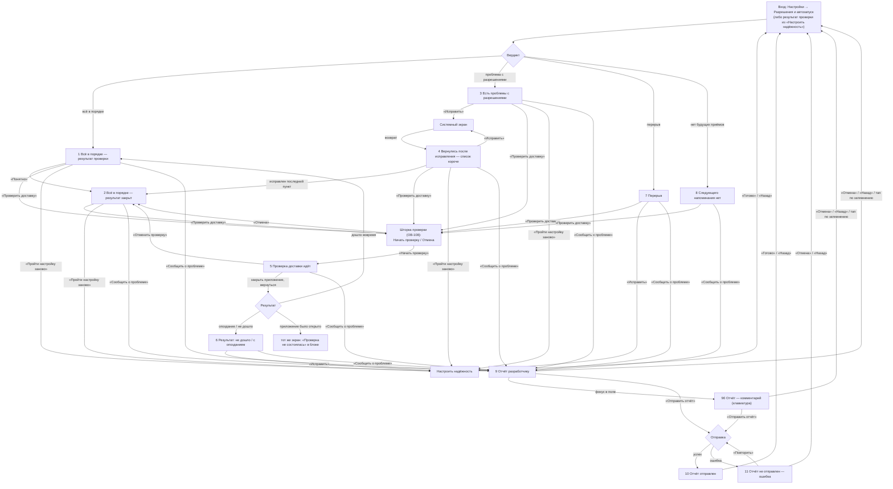

# «Проверка напоминаний» — UX-спецификация

Экран — единый ответ человеку, который пришёл, когда напоминания не приходят: **что не так →
что делать → когда было последнее и когда следующее**. Экран живёт на первом уровне
диагностики (ОВ-49, ОВ-126); технические сведения уезжают в отчёт разработчику (ОВ-127),
отдельных технических блоков на экране нет.

Этот документ — UX-надстройка над визуальным каноном. Обязательные источники:
- **макет** — `design/screens/Diagnostics.dc.html` (12 состояний одного экрана как один путь);
- **состав и тексты** — `03-screens.md` §«Проверка напоминаний»; `04-reminders.md` §9 (НАП-37,
  НАП-38, НАП-43);
- **компоненты и токены** — `08-design-system.md` (баннер §4.6, строка с действием §4.11,
  кнопки §4.3, поле §4.4, шторка §4.18, доступность §6);
- **решения** — `design-decisions.md` (ОВ-49, ОВ-82, ОВ-102, ОВ-106, ОВ-107, ОВ-108, ОВ-109,
  ОВ-110, ОВ-126, ОВ-127, ОВ-128).

Три раздела: **1) acceptance criteria**, **2) user-flow**, **3) customer journey**.
Термины: «вердикт» — элемент вверху экрана («Всё в порядке» либо баннер-предупреждение);
«разрешения» — секция с чек-листом; «блок проверки» — секция «Проверка доставки».

Размещение: `docs/spec/14-reminder-check-ux.md` — свободный номер после `13-monetization.md`;
документ не заменяет визуальный канон `03-screens.md` и тексты, а добавляет к ним проверяемые
критерии, карту переходов и путь человека.

**Область действия сетевой отправки (ПМ-32).** Отправка отчёта по сети — целевое поведение
экрана (ОВ-127). Она требует `INTERNET`, которого в первой публикации нет (ПМ-31), поэтому
реальная отправка выходит **вне первой версии**, вместе с возвратом сетевого контура; до этого
кнопка «Отправить отчёт» работает как **заглушка**. Критерии AC-32/AC-33 (успех/ошибка
отправки) проверяются на релизе с отчётным контуром; состав отчёта, отсутствие медданных
и необязательность комментария действуют всегда (НФТ-16б, ПМ-32).

Нумерация состояний ниже — по макету: 1 Всё в порядке (результат проверки), 2 Всё в порядке
(результат закрыт), 3 Есть проблемы с разрешениями, 4 Вернулись после исправления,
5 Проверка идёт, 6 Результат: не дошло / с опозданием, 7 Перерыв, 8 Следующего напоминания
нет, 9 Отчёт разработчику, 9б Отчёт — комментарий (клавиатура), 10 Отчёт отправлен,
11 Отчёт не отправлен.

---

## 1. Acceptance criteria

Каждый критерий наблюдаем и проверяется по экрану, без доступа к исходникам. Интеракции
записаны в формате **Given / When / Then**. Тексты дословно — из `03-screens.md`
§«Проверка напоминаний»; номера `ОВ-N`/`НАП-N` — ссылки на решения, а не на реализацию.

### 1.1 Порядок секций и вердикт

**AC-1. Единый порядок секций.** Во всех состояниях секции идут в одном порядке:
**вердикт → «Разрешения» → «Проверка доставки» → «Напоминания» → «Сообщить о проблеме»**.
Между состояниями меняются только вердикт и та секция, к которой относится изменение;
остальные секции и их заголовки-надстрочники остаются на месте и не меняют порядок.
*Проверка:* состояние 3 (проблемы), 6 (провал проверки) и 7 (перерыв) отличаются от
состояния 1/2 только вердиктом и содержимым одной секции.

**AC-2. Когда вердикт — строка «Всё в порядке».** Если ни одно разрешение не требует
действия, нет перерыва и нет неподтверждённого результата неудачной/опоздавшей проверки,
первым элементом контента стоит строка вердикта: галочка `Taken` на `TakenSoft`, заголовок
«Всё в порядке», подпись «Напоминания приходят вовремя.».
- Given: все разрешения выданы, перерыва нет, последняя проверка доставки не провалена.
- When: экран открыт.
- Then: первым элементом идёт вердикт-строка «Всё в порядке»; баннера над ней нет.

**AC-3. Когда вердикт — баннер.** Если есть причина, требующая действия, вместо строки
вердикта стоит `Banner` вида «Предупреждение» и называет **одну** старшую причину **теми же
словами**, что «Сегодня» и «Настроить надёжность» (ОВ-82, ОВ-107).
- Given: уведомления отключены, остальное выдано.
- When: экран открыт.
- Then: сверху баннер с текстом «Напоминания сейчас не приходят: уведомления отключены»;
  строки «Всё в порядке» нет; причина названа текстом, а не цветом (НФТ-30).

**AC-4. Где стоит действие баннера.** Если у причины есть строка с «Исправить» в секции
«Разрешения», действие живёт в строке, а баннер приводится без действия. Если строки нет
(перерыв), действие «Исправить» стоит в самом баннере и ведёт в «Настроить надёжность».
*Проверка:* состояние 3 — баннер без действия, «Исправить» в двух группах; состояние 7 —
баннер с действием «Исправить».

**AC-5. Перерыв — отдельное событие.** Перерыв показывается отдельным баннером ниже баннера
старшей причины (если он есть) либо вместо него (если разрешения исправлять нечего). Текст
называет дату и время: «Напоминания не приходили с <дата>, <время>. Приёмы за это время можно
отметить вручную.», действие — «Исправить». Постоянной строки «был перерыв» в других
состояниях нет.

**AC-6. Смысл не дублируется.** Вердикт не повторяет текст секций: «что не так», «что делать»
и «когда было/будет» встречаются на экране по одному разу. Результат проверки доставки
возникает как баннер один раз при входе и хранится в блоке проверки; второго вердикт-элемента
из-за него не появляется. Заголовок секции не дублируется заголовком карточки внутри неё
(внутри «Проверка доставки» нет второй надписи «Проверка доставки»).

**AC-7. Старшинство причины.** В баннере стоит одна причина по старшинству: «не приходят»
(уведомления, затем канал) выше «опаздывают» (точные будильники) выше «показываются
не полностью» (полноэкранные). Устоявшаяся пара «уведомления + точные будильники» называется
одной фразой. Если уведомления отключены, причина «канал» не показывается; «полноэкранные» —
только когда всё остальное в порядке.

### 1.2 «Разрешения» и действие «Исправить»

**AC-8. В карточке только то, что требует действия.** Выданные разрешения не разворачиваются:
под карточкой стоит футер «Остальные разрешения выданы» с галочкой `Taken`. Когда проблем нет,
вся секция — одна строка «Разрешения выданы» с галочкой.

**AC-9. Две группы по последствию.** В проблемном состоянии строки делятся на две группы
в порядке «что чинить первым»:
- «Исправьте сначала — иначе напоминания не придут или опоздают»;
- «Можно отложить — напоминания придут, но не полностью».

**AC-10. Статус строки — маркер и слово.** У строки есть маркер-плитка 40×40: «не выдано» —
предупреждающий вид (`AccentSoft` + глиф-треугольник `ProfileForeign`); «проверьте вручную»
и ограничения — нейтральный (`NeutralSoft` + глиф-сведения `TextMuted`). Под названием —
последствие словами, называющее, чем грозит. Смысл несут и глиф, и слово (НФТ-30): маркер
не единственный носитель.

**AC-11. Действие выровнено в колонку.** У каждой строки одно тихое действие **«Исправить ›»**;
подпись выровнена по левому краю колонки фиксированной ширины, шеврон `›` — по правому, поэтому
начала подписей и шевроны стоят на одной вертикали во всех строках. Цель нажатия — не меньше
44 dp. Нажатие открывает соответствующий системный экран.
- Given: строка «Точные будильники» с «Исправить».
- When: человек нажимает «Исправить».
- Then: открывается системный экран выдачи точных будильников; строка остаётся на месте,
  пока право не выдано.

**AC-12. «Пройти настройку заново».** Тихая строка-футер под карточкой «Разрешения» во всех
состояниях; подпись по левому краю карточки, шеврон по правому (та же сетка, что у строк),
цель ≥44 dp. Нажатие открывает «Настроить надёжность» (ОВ-106).

**AC-13. Возврат после выдачи разрешения.** Given: человек нажал «Исправить», выдал право
в системных настройках и вернулся. When: экран снова активен. Then: исправленная строка
исчезла; оставшиеся строки и футер «Остальные разрешения выданы» на месте; вердикт пересчитан
по старшей оставшейся причине (состояние 4).
- Given: исправлен последний пункт.
- When: экран снова активен.
- Then: секция сворачивается до строки «Разрешения выданы», а вердикт становится
  «Всё в порядке», если ничего другого не требует действия (состояния 1–2).

**AC-14. Без счётчиков и прогресса.** На экране нет «требуют внимания: N» и полосы прогресса
починки; приоритет несут заголовки групп, а обратную связь даёт исчезновение строки.

### 1.3 «Проверка доставки»

**AC-15. Запуск.** Given: базовое состояние с кнопкой «Проверить доставку». When: кнопка
нажата. Then: открывается существующая шторка ОВ-108 («Проверка доставки», инструкция
«…закройте приложение — смахните его из списка недавних…», «Начать проверку» / «Отмена»);
проверка ещё не запущена, блок не меняется.

**AC-16. Идёт.** Given: «Начать проверку» нажата. Then: в блоке проверки — нейтральная плашка
«Проверка идёт: тестовое напоминание сработает примерно через минуту. Закройте приложение.»
и тихая «Отменить проверку». Вердикт и «Разрешения» остаются такими, какими были при запуске:
проверка меняет только свой блок.

**AC-17. Отмена проверки.** Given: проверка идёт. When: «Отменить проверку». Then: тестовое
срабатывание снято, блок вернулся к кнопке «Проверить доставку»; результата не сохраняется.

**AC-18. Исход «Дошло вовремя».** Given: приложение было закрыто в момент срабатывания,
отклонение 0…+120 с. When: человек входит в приложение. Then: результат показан баннером один
раз, в блоке — «Последняя проверка пройдена: тестовое напоминание дошло вовремя.» и тихое
«Понятно»; вердикт — строка «Всё в порядке».
- Given: результат «Дошло вовремя» на экране.
- When: нажато «Понятно».
- Then: результат подтверждён и скрыт, блок вернулся к пояснению и кнопке «Проверить доставку»
  (состояние 2); повтор — обычный запуск «Проверить доставку».

**AC-19. Исход «Дошло с опозданием на N мин».** Then: в блоке текст «Проверка доставки:
тестовое напоминание пришло с опозданием на N мин. Телефон задержал его — проверьте настройки
запуска и энергосбережения.» и второстепенная кнопка «Исправить» (→ «Настроить надёжность»);
результат показан баннером один раз при входе.

**AC-20. Исход «Не дошло».** Then: в блоке текст «Проверка доставки не прошла: тестовое
напоминание не пришло. Проверьте настройки запуска и энергосбережения.» и кнопка «Исправить»
(→ «Настроить надёжность»); баннер-вердикт называет результат («Последняя проверка доставки
не прошла.»).

**AC-21. Исход «Проверка не состоялась».** Given: приложение было открыто в момент
срабатывания. Then: текст «Проверка не состоялась: приложение было открыто. Закройте его
и попробуйте снова.» показан прямо в блоке, без баннера-вердикта, и закрывается тихим
«Понятно»; баннера при входе не даёт.

**AC-22. Результат хранится, но не повторяется бесконечно.** Результат показывается баннером
один раз при входе и сохраняется в блоке до «Понятно»; повторное открытие экрана не удваивает
сообщение и не создаёт второго вердикта.

**AC-23. Повтора проверки нет.** Единственный вход в проверку — кнопка «Проверить доставку»;
отдельной кнопки «Повторить проверку» в блоке нет ни в одном состоянии (ОВ-126, ОВ-128).

**AC-24. Тестовое напоминание — не приём.** Тестовое срабатывание проходит боевой путь
(точный будильник, обычный канал, полноэкранная карточка) и показывает карточку с
надзаголовком «Проверка доставки» и подписью «Тестовое напоминание. Отмечать ничего не нужно.»;
записи приёма, истории и остатка не создаются, на «Сегодня» проверка не показывается,
её запись в журнале отличима от реальных срабатываний (НАП-43).

### 1.4 Сводка и напоминания

**AC-25. Сводка 7 дней.** Секция открывается одной тихой фразой; оба числа склоняются
(`plurals`), «0» числом не показывается. Четыре формулировки (ОВ-102):
- оба числа > 0: «За 7 дней сработало N напоминаний, пропущено M приёмов»;
- пропусков нет: «За 7 дней сработало N напоминаний, пропусков нет»;
- срабатываний нет: «За 7 дней напоминаний не показывалось, пропущено M приёмов»;
- ничего нет: «За 7 дней напоминаний не было».

«Сработало» считает предъявления (`SHOWN`), «пропущено» — `MISSED_SWEEP`; «0 из 0» и «0 %»
не показываются.

**AC-26. Последнее напоминание.** Карточка «Последнее напоминание» называет лекарство, время
плана и факт: «Показано в <время> · вовремя» либо отклонение словом. Опоздавшие обычные
срабатывания, не предъявленные человеку (порог 30 мин, ОВ-109), сюда не попадают.

**AC-27. Следующее напоминание.** Карточка «Следующее напоминание» называет лекарство, время
и подпись «· план» (это план, а не гарантия — ОВ-77), а под ней — пояснение: «Это время
телефон показывает в статус-баре как будильник — так и должно быть.» (ОВ-110).

**AC-28. Следующего напоминания нет.** Если будущих приёмов нет, карточка показывает
«Пока не запланировано» и объяснение «Активных лекарств с расписанием нет — напоминать пока
не о чем.»; вердикт-строка остаётся «Всё в порядке» и уточняет «Новых пока не запланировано.».
Это не ошибка и не повод чинить; баннера нет.

### 1.5 «Сообщить о проблеме» и отчёт разработчику

**AC-29. Постоянный низ.** «Сообщить о проблеме» с подписью «Технический отчёт для
разработчика. Без названий лекарств и истории приёмов.» видна в каждом базовом состоянии
(1–8), включая «проверка идёт», «провал проверки» и «перерыв». Под шторкой отчёта (9, 9б, 10,
11) блок остаётся под затемнением и не дублируется.

**AC-30. Открытие шторки.** Given: человек нажал «Сообщить о проблеме». Then: снизу
открывается шторка «Отчёт разработчику»; шапка «Отмена» / «Отчёт разработчику»; одно короткое
объяснение «Технический отчёт для разработчика — по вашему нажатию. Он собирается
автоматически и не содержит названий лекарств, доз и истории приёмов.»; поле «Что не работает?»;
действие «Отправить отчёт».

**AC-31. Комментарий необязателен.** Поле многострочное (≈3–4 строки), подпись над полем,
рядом «необязательно», плейсхолдер «Например: напоминание не приходит утром». «Отправить отчёт»
доступна при пустом поле; ошибки у поля нет; перечня состава отчёта в шторке нет.

**AC-32. Отправка и успех.** Given: человек нажал «Отправить отчёт». Then: отчёт уходит по сети
(решение ОВ-127), и содержимое шторки заменяется состоянием успеха: «Отчёт отправлен»,
«Спасибо! Это помогает сделать напоминания надёжнее.», галочка. Выход — «Готово», системная
«Назад» или тап по затемнению; комментарий на успех не влияет.

**AC-33. Ошибка отправки.** Given: отправить не удалось. Then: содержимое шторки показывает
предупреждение «Не удалось отправить отчёт. Проверьте подключение к интернету и попробуйте
снова. Введённый текст сохранён.» и одно действие «Повторить»; поле/комментарий сохранены;
«Отмена» закрывает шторку, ничего не отправляя. Повтор приводит к успеху (10) или снова
к ошибке (11).

**AC-34. Клавиатура.** Given: поле получило фокус. Then: полотно шторки поднято ровно на высоту
системной клавиатуры (IME-inset, §3.4/§4.18); поле видно целиком, «Отправить отчёт» остаётся
над клавиатурой, заголовок закреплён, средняя часть прокручивается; сверху может быть обрезана
только плашка-объяснение, но не поле.

**AC-35. Шторка закрывается без исхода.** «Отмена», системная «Назад» и тап по затемнению
закрывают шторку и возвращают к экрану без изменений; нажатия по содержимому под затемнением
не проходят, фокус чтения при открытии переходит в шторку, при закрытии возвращается
на «Сообщить о проблеме».

### 1.6 Переходы и возвраты

**AC-36. Точка входа — «Настройки».** Строка «Разрешения и автозапуск» открывает «Проверку
напоминаний» (ОВ-48/ОВ-49). Явная стрелка «Назад» и системная «Назад» возвращают в «Настройки»;
состояние экрана при возврате не теряется.

**AC-37. Возврат из системных настроек.** Возврат из-за «Исправить» перечитывает разрешения
и вердикт без перезапуска (AC-13); ничего не фиксируется молча.

**AC-38. «Настроить надёжность» и обратно.** «Пройти настройку заново» (AC-12) и «Исправить»
из баннера перерыва / блока проверки открывают «Настроить надёжность»; «Готово» и системная
«Назад» возвращают к «Проверке напоминаний», состав перечитывается.

**AC-39. Проверка при уходе с экрана.** Уход с экрана при идущей проверке не отменяет
тестовое срабатывание: результат появится при следующем входе (успех/опоздание/не дошло);
«не состоялась» — только если приложение было открыто в момент срабатывания.

**AC-40. Шторка отчёта и уход.** После отправки (10) или ошибки (11) возврат к базовому экрану
возможен без отправки; повторная «Сообщить о проблеме» открывает шторку заново с пустым полем.

### 1.7 Доступность, крупный шрифт, цели нажатия

**AC-41. Цели нажатия.** Все интерактивные элементы — не меньше 44 dp: строки «Исправить»
и «Пройти настройку заново», кнопки «Проверить доставку», «Отменить проверку», «Понятно»,
«Сообщить о проблеме», «Отправить отчёт», «Повторить», «Отмена». Визуальный размер может быть
меньше — цель расширяется невидимо (§3.3, ОВ-17).

**AC-42. Крупный системный шрифт (до 200 %).** Ни один текст не обрезается и не рвётся
по буквам: строки «Разрешения» растут по высоте, действие уходит под текст (`StackingRow`),
карточки и кнопки растут (§6.3). Секция «Сообщить о проблеме» и шторка остаются достижимыми,
ничего не перекрывается.

**AC-43. Смысл не только цветом (НФТ-30).** Статус приёма/доставки/разрешения всегда назван
словом или числом, а не одним цветом или значком: «не выдано» / «проверьте вручную», «вовремя» /
«опоздание», «Всё в порядке» / текст причины.

**AC-44. Читаемость.** Минимальный текст — 12 px; контраст пар — из §6.1; приглушённый
`#8C8177` и жёлтый не используются. Строка-действие не несёт смысла одной иконкой: у неё
подпись словами.

**AC-45. Чтение с экрана.** Порядок обхода совпадает с визуальным; у иконочных кнопок есть
описание; статусная строка «Всё в порядке» и баннер читаются как единое сообщение
(заголовок + пояснение); шеврон `›` в подписи действия декларативно не объявляется.

---

## 2. User-flow

### 2.1 Входные точки

Прямой вход в «Проверку напоминаний» один — строка настроек; остальные точки ведут
в «Настроить надёжность» и уже оттуда человек приходит к проверке или возвращается к разбору.

| Откуда | Куда попадает | Что делает дальше | Возврат |
|---|---|---|---|
| «Настройки» → «Разрешения и автозапуск» | **«Проверка напоминаний»** (ОВ-48/49) | читает вердикт, чинит разрешения, при желании запускает проверку | «Назад» → «Настройки» |
| «Сегодня» → баннер ненадёжности «Настроить» / баннер перерыва «Исправить» | «Настроить надёжность» (ОВ-82/107), фокус на первом незакрытом шаге | чинит разрешения EMUI | «Готово»/«Назад» → «Сегодня» (предупреждение/перерыв остаются) |
| Первый запуск (онбординг) | Согласие (ОВ-123) → «Настроить надёжность» → `WatchSetup` | проходит настройку | «Дальше»/«Пропустить» |
| Уведомление (напоминание) | ОС показывает карточку; человек открывает приложение | замечает проблему «не пришло / пришло поздно», идёт в «Сегодня» или «Настройки» | — |
| «Настроить надёжность» (состояние «Всё настроено») → «Проверить доставку» | шторка проверки → результат на «Проверке напоминаний» | запускает тестовое напоминание | «Готово» → назад |
| «Проверка напоминаний» → «Пройти настройку заново» | «Настроить надёжность» | проходит цепочку заново | «Готово» → обратно на диагностику |

Заметка: из «Сегодня» диагностика напрямую не открывается — баннер ведёт в «Настроить
надёжность» (ОВ-82/ОВ-107), а диагностика остаётся доступной из настроек (ОВ-49). Это
намеренно: с «Сегодня» сначала чинят, а в диагностику приходят, чтобы понять «почему».

### 2.2 Диаграмма переходов

### 2.3 Основной путь по шагам

1. **Вход.** Человек открывает «Настройки» → «Разрешения и автозапуск»; открывается «Проверка
   напоминаний». Пока он читает, приложение уже перечитало состояние разрешений и результат
   последней проверки.
2. **Вердикт.** Сверху — строка «Всё в порядке» либо баннер с одной старшей причиной; если
   был перерыв — отдельный баннер с датой ниже. Человек понимает «работает / не работает»
   до того, как начнёт листать.
3. **Разрешения.** Если есть проблема — карточка с двумя группами, «Исправить» напротив каждой
   строки и последствием словами. Человек нажимает «Исправить» → системный экран → выдаёт право →
   возвращается. Строка исчезает, вердикт пересчитывается (состояние 4). Когда исправлен
   последний пункт, карточка сворачивается до «Разрешения выданы» (состояния 1–2).
4. **Проверка доставки (по желанию).** «Проверить доставку» → шторка с инструкцией →
   «Начать проверку» → блок «Проверка идёт» (состояние 5) с «Отменить проверку». Человек
   закрывает приложение (смахивает из недавних); при следующем входе приходит результат:
   «Дошло вовремя» (состояние 1), «Дошло с опозданием» / «Не дошло» (состояние 6) или
   «Проверка не состоялась» (прямо в блоке). Успех закрывается «Понятно» (состояние 2),
   неудача ведёт «Исправить» → «Настроить надёжность».
5. **Напоминания.** Ниже — сводка 7 дней, последнее (только предъявленные) и следующее
   («план» + пояснение про индикатор будильника). Если будущих нет — «Пока не запланировано»
   (состояние 8).
6. **Отчёт.** В любом состоянии внизу — «Сообщить о проблеме» → шторка «Отчёт разработчику»
   (состояние 9). Человек при желании пишет «что не работает» (состояние 9б), нажимает
   «Отправить отчёт» → «Отчёт отправлен» (состояние 10) либо ошибка и «Повторить»
   (состояние 11). «Отмена» в любой момент закрывает шторку.
7. **Выход.** «Назад» возвращает в «Настройки»; «Пройти настройку заново» уводит в «Настроить
   надёжность», откуда «Готово» возвращает обратно.

### 2.4 Что показывается в каком состоянии

| Состояние | Вердикт | Разрешения | Проверка доставки | Напоминания | Низ |
|---|---|---|---|---|---|
| 1 | строка «Всё в порядке» | «Разрешения выданы» | успех + «Понятно» | сводка, последнее, следующее | «Сообщить» |
| 2 | строка «Всё в порядке» | «Разрешения выданы» | пояснение + кнопка | сводка, последнее, следующее | «Сообщить» |
| 3 | баннер, причина | две группы + «Исправить» | пояснение + кнопка | сводка, последнее, следующее | «Сообщить» |
| 4 | баннер, оставшаяся причина | одна группа + футер | пояснение + кнопка | сводка, последнее, следующее | «Сообщить» |
| 5 | как при запуске | как при запуске | плашка + «Отменить проверку» | сводка, последнее, следующее | «Сообщить» |
| 6 | баннер, провал проверки | «Разрешения выданы» | текст исхода + «Исправить» | сводка, последнее, следующее | «Сообщить» |
| 7 | баннер перерыва + «Исправить» | «Разрешения выданы» | пояснение + кнопка | сводка, последнее, следующее | «Сообщить» |
| 8 | строка «Всё в порядке. Новых пока не запланировано.» | «Разрешения выданы» | пояснение + кнопка | сводка, последнее, «Пока не запланировано» | «Сообщить» |
| 9 / 9б | как у базового состояния | как у базового | как у базового | как у базового (обрезано шторкой) | под затемнением |
| 10 | как у базового (под затемнением) | — | — | — | — |
| 11 | как у базового (под затемнением) | — | — | — | — |

---

## 3. Customer journey

**Персона.** Галина Петровна, 68 лет. Принимает Эутирокс утром и Магний B6 вечером; заводила
лекарства сама или с помощью родных. Телефон — Huawei на EMUI. Привыкла доверять телефону
и статус-бару: если там стоит будильник, значит, «всё поставлено». Крупный системный шрифт.

**Триггер.** Однажды утром таблетку выпила, только когда вспомнила сама, — карточка не пришла
или пришла, когда уже ушла из дома. Позже уведомление о вечернем приёме тоже опоздало.
Вопрос «приложение сломалось или я что-то не так настроила?» без ответа. Человек открывает
«Настройки» в поисках объяснения.

### Этапы пути

| Этап | Что думает / чувствует | Что делает | Что помогает на экране | Где можно запутаться |
|---|---|---|---|---|
| 1. Заметил проблему | «Почему не напомнило? Я же поставила. Наверное, опять что-то с телефоном» | Вспоминает, пришло ли уведомление; замечает будильник в статус-баре | — | Не понимает, «не пришло» и «пришло поздно» — разные вещи |
| 2. Открыл | «Где тут посмотреть, почему не работает?» | «Настройки» → «Разрешения и автозапуск» | Строка настроек называет задачу словами; заголовок «Проверка напоминаний» | Ожидает готового «выключено/включено», а получает список |
| 3. Понял причину | «Ага, право на точные будильники не выдано — вот почему сдвинулось» | Читает вердикт-баннер, затем карточку | Баннер одной фразой + строки с последствием словами и маркером | Пропускает баннер и сразу листает; путает «не выдано» и «проверьте вручную» |
| 4. Сделал шаг | «Нажму «Исправить» — вроде ведёт туда, где включить» | Нажимает «Исправить», выдаёт право, возвращается | Подпись «Исправить ›», последствие, выравненная колонка | Не понимает, почему после возврата список стал короче, — если не видит футер «Остальные разрешения выданы» |
| 5. Убедился | «Оно дошло? Теперь точно придёт?» | Запускает «Проверить доставку», закрывает приложение, входит снова | Блок проверки: инструкция → «Проверка идёт» → результат; «Понятно» | Боится, что проверка «ничего не сохранит»; путает «смахнуть из недавних» с «выключить телефон» |
| 6. Закрыл / вернулся | «Всё в порядке — буду пить спокойно» или «Не дошло — что ещё нажать?» | Закрывает экран либо идёт в «Настроить надёжность» | Строка «Всё в порядке»; неудача ведёт «Исправить»; «Сообщить о проблеме» | Не знает, что делать дальше при неудаче, — если не нажмёт «Исправить» |

### Обещания продукта на этом пути

- **Место.** Экран не отправляет человека в чат поддержки за базовым ответом: «что не так»
  и «что делать» называются на месте, в терминах самого телефона («право на точные будильники»,
  «автозапуск»), теми же словами, что на «Сегодня» и «Настроить надёжность».
- **Технический отчёт — без медицинских данных.** Отчёт разработчику собирается автоматически
  и не содержит названий лекарств, доз, расписания и истории приёмов; это написано в шторке
  рядом с полем комментария (ОВ-126, ОВ-127). Человек видит, что его лекарства никуда не уходят.
- **Отправка по сети — осознанное действие.** Отчёт уходит по сети только по нажатию
  «Отправить отчёт»; без этого нажатия приложение наружу ничего не отправляет. Комментарий
  необязателен — отчёт ценен и без него, и человека 60+ не заставляют печатать.
- **Приложение не медицинское.** Экран объясняет надёжность доставки, но не даёт медицинских
  советов и не оценивает приём; «Приёмы за это время можно отметить вручную» — единственная
  отсылка к действию, и она про отметку, а не про здоровье.
- **Не ловушка.** С любого шага можно выйти: «Назад», «Отмена», тап по затемнению. Проверка
  не блокирует телефон и не требует ждать на экране — можно закрыть приложение и вернуться
  позже.

### Что считается успехом

1. **Понимание.** Прочитав экран, человек может своими словами сказать, почему напоминания
   не пришли/опоздали (причина названа словами) и что он с этим сделал.
2. **Действие.** «Исправить» уводит прямо в нужный системный экран; после возврата исправленная
   строка исчезла, а вердикт пересчитан — без перезапуска приложения.
3. **Уверенность.** «Проверить доставку» даёт увидеть результат своими глазами: успех —
   «дошло вовремя» и «Понятно»; неудача — понятный следующий шаг.
4. **Спокойствие.** Тон экрана ровный: ни тревожных красных заливок, ни обещаний, которых
   приложение не выполнит («проверю» вместо «должно сработать»); перерыв — событие с датой,
   а не «всё сломалось».
5. **Доверие данных.** Отчёт не содержит медицинских данных, уходит только по нажатию
   и не требует комментария; приватность названа в шторке.
6. **Без тупика.** Из каждого состояния есть выход и следующий шаг: у разрешений — «Исправить»,
   у перерыва — «Исправить», у неудачной проверки — «Исправить», у отчёта — «Отмена»/«Готово».
