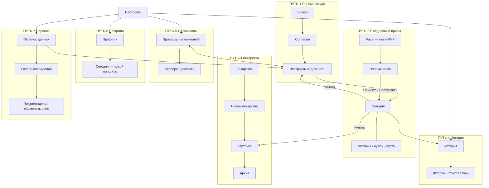

# Пути человека — user-flow и customer journey

Реестр всех путей «Склянки»: зачем человек проходит через экраны, откуда он приходит,
что может потерять и как выглядит успех. Документ нужен, чтобы дизайн не распадался
на несвязанные экраны: каждый экран в `03-screens.md` живёт внутри пути, названного здесь.

Источники и разграничение:

- `03-screens.md` («Карта экранов», «Навигация») — **факты** о экранах и переходах; здесь
  пути сводятся и проверяются на связность.
- `08-design-system.md` — токены и компоненты, на которые опираются состояния.
- `NN-…-ux.md` — **UX-спецификация сложного пути** (acceptance criteria + user-flow +
  customer journey); эталон — `14-reminder-check-ux.md`. Реестр лишь указывает, у какого
  пути такая спека есть.
- `design-decisions.md` — журнал решений; `12-open-questions.md` — реестр открытого.
- `00-overview.md` — сценарии А и Б, цели Ц-1…Ц-6, принципы П-1…П-5.
- `09-scope.md` — граница объёма: путь «человек начал курс и ни разу не пропустил приём
  по вине приложения».

Коды путей — **ПУТЬ-N**. Нумерация не переиспользуется; новый путь получает следующий
свободный номер. Путь без макета или без экрана — нормально: у него есть вход и выход,
а экраны могут быть не нарисованы (тогда это названо открытым вопросом).

---

## Сквозной путь (customer journey)

Один общий путь, внутри которого лежат все частные, — «начал курс и ни разу не пропустил
приём по вине приложения» (`09-scope.md`). Этапы и обещание на каждом:

| Этап | Что человек делает | Обещание продукта | Код цели |
|---|---|---|---|
| Настройка | ставит приложение, решает про аналитику, выдаёт разрешения EMUI | «напоминание придёт в назначенную минуту и переживёт систему» | Ц-1 |
| Заведение | вносит препарат, расписание, дозу, остаток; при потребности — лимит | «форма понятна с первого раза, ничего не надо помнить» | У-5 |
| Ежедневные приёмы | отмечает приёмы — с телефона или часов, за одно нажатие | «в любой момент видно, принял ли я и что осталось» | Ц-2 |
| Остаток | видит, что упаковка кончается, заранее | «предупреждение до срыва приёма, а не после» | Ц-5 |
| Присмотр (Б) | переключается в профиль подопечного, отмечает его приёмы | «чужой приём не станет моим, и наоборот» | Ц-3 |
| Завершение | закрывает курс, убирает лишнее, возвращает из архива | «история не потеряется» | Ц-4 |
| Врач | показывает историю и передаёт отчёт | «записи соответствуют тому, что было» | Ц-4 |
| Смена устройства | выгружает и загружает один файл | «данные остаются у человека, без облака и аккаунта» | Ц-6 |
| Сбой | приходит, когда напоминания не приходят, и чинит | «понятно, что не так и что делать» | Ц-1 |

Точки, где путь чаще всего рвётся (по ним и стоит проектировать в первую очередь):
**первый запуск** (разрешения EMUI — У-4), **заведение лекарства** (У-5), **сбой доставки**
(«Проверка напоминаний»), **необратимые действия** («Заменить всё», удаление профиля, архив).

Сквозное для всех путей: **шапка экрана при прокрутке** (ОВ-133, утверждено заказчиком
04.10.2026). Крупный заголовок и
служебные блоки шапки уезжают вместе с контентом, возврат и функциональное действие остаются
доступны в неподвижном компактном ряду; это одинаково на всех экранах с крупным заголовком
и не различает пути. Правило — `08-design-system.md` §4.9, демонстрация — `docs/design-proposals/header-scroll.html`.

---

## Сводная таблица путей

| ID | Путь | Сценарий | Обещание (зачем) | Ключевые экраны | UX-спека |
|---|---|---|---|---|---|
| ПУТЬ-1 | Первый запуск и настройка надёжности | А, Б | приложение готово напоминать | Заставка → Согласие → Настроить надёжность → Сегодня | нет (кандидат) |
| ПУТЬ-2 | Ежедневный приём и отметка | А, Б | принял и отмечено, или пропустил осознанно | Сегодня (+ плотный, чужой, пусто), Напоминание | нет (кандидат) |
| ПУТЬ-3 | Ведение лекарства, архив, пополнение | А, Б | курс заведён и остаток под контролем | Лекарства, Новое лекарство, Карточка, Архив | нет (кандидат) |
| ПУТЬ-4 | История и отчёт врачу | А, Б | записи соответствуют тому, что было; отчёт передан | История, шторка «Отчёт врачу» | нет (кандидат) |
| ПУТЬ-5 | Надёжность: «напоминания не приходят» | А, Б | понятно, что не так, и есть выход | Сегодня (баннер), Проверка напоминаний, Настроить надёжность | **`14-reminder-check-ux.md`** |
| ПУТЬ-6 | Профили и присмотр | Б | чужой приём не станет моим | Настройки → Профили, Сегодня (чужой профиль) | нет (кандидат) |
| ПУТЬ-7 | Перенос данных | А, Б | данные переносятся одним файлом | Перенос данных, разбор совпадений, подтверждение | нет (кандидат) |

«Кандидат» в колонке UX-спеки — путь, для которого спеки пока нет; она заводится, когда
дизайн берётся за этот путь (много состояний, необратимое действие или путь-жалоба).

---

## ПУТЬ-1 · Первый запуск и настройка надёжности

**Зачем.** Человек впервые открывает приложение и доводит его до рабочего состояния:
разрешения EMUI выданы, аналитика решена, первый экран «Сегодня» честно показывает, что
делать дальше. Без этого пути напоминания не работают, а продукт теряет смысл (П-1).

**Экраны и маршрут.** `Splash` → «Согласие на аналитику» → «Настроить надёжность»
→ (Подключение часов — пост-MVP, `ADR-0009`) → `Main` (ПМ-25, ОВ-123).

**Входные точки.** Только первый запуск — один раз. Дальше точки входа в тот же экран
«Настроить надёжность» живут в ПУТЬ-5: баннер на «Сегодня», строка «Разрешения и автозапуск»
в настройках, тихое «Пройти настройку заново» на диагностике.

**Развилки и края.**
- Аналитика: «Разрешить» и «Продолжить без аналитики» ведут одинаково — на онбординг
  (отказ не блокирует, ПМ-8; ОВ-123). Системная «Назад» = отказ.
- Показ согласия может быть отложен ярлыком «Добавить лекарство» (ОВ-105) — тогда он
  показывается при следующем обычном запуске (ПМ-25 п. 5).
- «Настроить надёжность»: пять шагов; «Дальше», «Пропустить, настрою позже» и системная
  «Назад» (прерывает онбординг как пропуск) ведут на «Сегодня»; при пропуске в настройках
  остаётся статус «Одно не выдано» (ОВ-86).
- Вендорные шаги («Запуск приложений», «Энергосбережение», «Закрепление») приложение
  проверить не может — подтверждаются словом человека (НАП-20).

**Риск.** Человек не выдаёт разрешения и потом не понимает, почему тихо. Лечится не этим
экраном, а баннером и диагностикой (ПУТЬ-5).

**UX-спека.** Нет. Кандидат: путь длинный, с откатом и непроверяемыми шагами.
**Источники.** `03-screens.md` «Заставка», «Согласие на аналитику», «Настроить надёжность»;
ПМ-18/19/20/25; ОВ-86, ОВ-105, ОВ-123; НАП-20; Ц-1, У-4.

---

## ПУТЬ-2 · Ежедневный приём и отметка

**Зачем.** Ядро продукта: в назначенную минуту поднять приём, дать отметить одним нажатием
и оставить след, по которому в любой момент видно, принял ли человек лекарство (Ц-2).

**Экраны и маршрут.** Уведомление поднимает `Reminder` → действие закрывает карточку →
`Main` со снэкбаром «Отменить». Основной экран — «Сегодня» (`Main`), с видами: плотный день
(`MainDense`), чужой профиль (`MainProfile`), пусто (`Empty`). Часы (`Watch`) — пост-MVP.

**Входные точки.**
- Точный будильник: полноэкранная карточка `Reminder` (главный вход, П-1).
- Открытие приложения: вкладка «Сегодня» (в любой момент).
- Отметка с часов (зеркалирование, сценарий Б).
- Ярлык «Добавить лекарство» — в ПУТЬ-3, но не перебивает живое окно отмены (ОВ-105).

**Развилки и края.**
- «Принято» / «Отложить N мин» (интервал из настроек) / «Пропустить» (ОВ-98).
- Несколько приёмов на одно время — одна карточка со списком; отметка строки независима
  (НАП-36). Групповая отметка — по одной по умолчанию, батч вторым тапом (ОВ-32).
- Частичная отметка карточку не закрывает и отмены не получает; снэкбар — только если
  действие закрыло карточку (ОВ-81, SKL-30).
- Истечение окна `pending → missed`; порог зависит от открытого окна (ОВ-4).
- Опоздавшее обычное срабатывание (>30 мин) не показывается (ОВ-109).
- Просроченный приём уже на «Сегодня» — приглушён без кнопок (ОВ-35).
- Плотный день: свёртка по времени суток (ОВ-32); ссылка «Принято N из M» ведёт в историю
  (ОВ-84).
- Остаток: плашка «Купить» ведёт в карточку на блок «Остаток» (ПУТЬ-3), покупки нет.

**Риск.** Двойная отметка (телефон/часы) — идемпотентна по `intake_id`, выигрывает первая
по `acted_at`; «Отменить» живёт только в окне, пока процесс живой (SKL-43).

**UX-спека.** Нет. Кандидат: путь самый частый, много состояний отметки.
**Источники.** `03-screens.md` «Сегодня», «… плотный день», «… чужой профиль», «… пусто»,
«Напоминание»; ОВ-32, ОВ-35, ОВ-81, ОВ-84, ОВ-98, ОВ-105, ОВ-109; НАП-31/36; SKL-30/31/43;
Ц-2.

---

## ПУТЬ-3 · Ведение лекарства, архив и пополнение

**Зачем.** Завести курс один раз понятно (У-5), держать остаток под контролем (Ц-5),
не потерять историю, когда курс кончается (Ц-4).

**Экраны и маршрут.** Вкладка «Лекарства» (`Meds`) → «Новое лекарство» (`AddMed`) ↔
«Карточка лекарства» (`MedCard`) → «Архив» (`Archive`) и обратно.

**Входные точки.** Вкладка «Лекарства»; круглая кнопка добавления; ярлык «Добавить
лекарство» (ОВ-96/105); плашка остатка «Купить» на «Сегодня» → `MedCard` на блоке «Остаток».

**Развилки и края.**
- Режим расписания vs «по потребности» (`prn`): у PRN нет времён и связи с едой, есть
  «не чаще N раз в сутки» (ОВ-83, ОВ-85, ОВ-36).
- Ошибочно заведённое лекарство до первой отметки — мягкое удаление (скрывается везде,
  записи сохраняются); после первой отметки — только архив (ПМ-24, ПР-14).
- Архив раздельно: «курс завершён» и «убрано вручную»; возврат из архива (ОВ-40, ОВ-43).
- Пополнение: «Пополнить» заменяет остаток новым числом, размер упаковки не меняется
  (ОВ-13), «N из M» и полоса (ОВ-45).
- Ошибки формы: девять правил валидации, состояния ошибки (ОВ-38).

**Риск.** Молчаливая потеря лекарства (мягкое удаление до отметки) или случайный архив.
**UX-спека.** Нет. Кандидат: форма длинная, есть необратимые и рискованные шаги.
**Источники.** `03-screens.md` «Лекарства», «Новое лекарство», «Карточка лекарства»,
«Архив»; ОВ-13, ОВ-36, ОВ-38, ОВ-40, ОВ-43, ОВ-45, ОВ-83, ОВ-85, ОВ-88, ОВ-94; ПМ-24;
ПР-14; У-5, Ц-4, Ц-5.

---

## ПУТЬ-4 · История и отчёт врачу

**Зачем.** Ответить на вопрос врача «пили как назначено?» записями, а не памятью (Ц-4).

**Экраны и маршрут.** Два входа в `History`: вкладка «Настройки» → «Данные» → «История
приёмов» и строка прогресса «Принято N из M» на «Сегодня» (ОВ-84) → шторка «Отчёт врачу»
→ системное «Поделиться» / сохранение файла.

**Входные точки.** Настройки → «История приёмов»; «Сегодня» → строка прогресса. Возврат —
туда, откуда пришли (место входа хранится).

**Развилки и края.**
- Месяц назад/вперёд; день календаря раскрывает приёмы дня (ОВ-84).
- Отчёт: пресеты «Этот месяц» / «Прошлый месяц» / «Последние 3 месяца» / «Другой период»
  (ОВ-125); пустой период — фраза, а не прочерки; отмена и ошибка — в шторке, успех —
  отдельным состоянием (ОВ-125).
- Чужой профиль: отметки владельца подписаны «отметили вы»; индикация профиля — правка.
- Данных за месяц нет — прочерки, календарь пуст (макета нет).

**Риск.** Отчёт содержит медицинские данные и передаётся в открытом виде — предупреждение
стоит тихой строкой (НФТ-18).
**UX-спека.** Нет. Кандидат.
**Источники.** `03-screens.md` «История»; ОВ-15, ОВ-84, ОВ-100, ОВ-125; SKL-101;
НФТ-14/15/18; Ц-4.

---

## ПУТЬ-5 · Надёжность: «напоминания не приходят»

**Зачем.** Человек пришёл, когда напоминания не приходят или приходят поздно: понять
«что не так → что делать → когда было последнее и когда следующее» и починить (Ц-1).

**Экраны и маршрут.** «Сегодня» → баннер ненадёжности / перерыва → «Настроить надёжность»;
«Настройки» → «Разрешения и автозапуск» → **«Проверка напоминаний»**; диагностика ↔
«Настроить надёжность»; шторка «Проверить доставку» → результат; шторка «Отчёт разработчику».

**Входные точки.** Настройки → «Разрешения и автозапуск» (прямой вход в диагностику);
«Сегодня» → баннер «Настроить»/«Исправить» (ведёт чинить, не в диагностику); результат
самопроверки доставки при следующем входе.

**Развилки и края.** 12 состояний: вердикт → «Разрешения» → «Проверка доставки» →
«Напоминания» → «Сообщить о проблеме»; исправление разрешений, возврат и пересчёт; успех /
опоздание / «не состоялась»; отчёт отправлен / не отправлен. Верхний элемент — один по
старшинству (причина ненадёжности старше провала доставки; ОВ-130), провал доставки даёт один
баннер-вердикт без второго (ОВ-131). Полный разбор — в спеке.

**Риск.** Ложное «всё в порядке»; отчёт разработчику уходит по явному нажатию и не содержит
медданных; в первой публикации сети нет — отправка работает заглушкой (ПМ-31/32).
**UX-спека.** **Есть: `14-reminder-check-ux.md`** (acceptance criteria + user-flow +
customer journey) — эталон формата для остальных путей.
**Источники.** `03-screens.md` «Проверка напоминаний», «Настроить надёжность», «Сегодня»;
`14-reminder-check-ux.md`; ОВ-48/49/82/102/106/107/108/109/110/126/127/129/130/131/132;
ПМ-32; Ц-1, У-4.

---

## ПУТЬ-6 · Профили и присмотр (сценарий Б)

**Зачем.** Взрослый ведёт приёмы подопечного со своего телефона и ни разу не путает чужой
приём со своим (Ц-3, П-2). Это присмотр, а не многопользовательский режим (НЦ-8).

**Экраны и маршрут.** «Настройки» → «Профили» (строки «Мои лекарства», «Мама»,
«Добавить профиль») → переключение профиля → «Сегодня» в контексте профиля
(`MainProfile`). Экраны добавления профиля и карточки профиля в макетах **отсутствуют** —
открытый вопрос (ОВ-3); удаление профиля решено отдельным экраном (ОВ-7).

**Входные точки.** Строка профиля в настройках или переключатель профиля в шапке «Сегодня»
(место в шапке освобождается удалением лишней шестерёнки).

**Развилки и края.**
- Переключение профиля: весь интерфейс в его контексте; избыточная индикация чужого
  профиля намеренна (полоса, подкрашенная шапка, «Это не ваши приёмы», свой акцент).
- `mirror_reminders` — дублировать ли напоминания профиля на устройство владельца;
  подпись «напоминания дублируются мне» в списке.
- Удаление профиля: строка в «Профилях», экран с числами и словом «Удалить», выгрузка (ОВ-7).
- История чужого профиля: подпись «отметили вы» (У-3; `03-screens.md` «История»).

**Риск.** Отметить чужой приём как свой — самая дорогая ошибка продукта.
**UX-спека.** Нет. Кандидат: части пути (добавление и карточка профиля) ещё не нарисованы.
**Источники.** `03-screens.md` «Сегодня — чужой профиль», «Настройки»; `00-overview.md`
сценарий Б, П-2; `09-scope.md` §1.1; ОВ-7; Ц-3, У-3.

---

## ПУТЬ-7 · Перенос данных

**Зачем.** Данные остаются у человека и переносятся на новое устройство одним файлом,
без облака и учётной записи (Ц-6, П-5).

**Экраны и маршрут.** «Настройки» → «Перенос данных» → «Сохранить файл» (выгрузка) или
«Выбрать файл» (загрузка) → [разбор совпадений] → [подтверждение «Заменить всё»] →
результат → «Настроить надёжность» (разрешения файлом не переносятся).

**Входные точки.** Настройки → «Перенос данных».

**Развилки и края.**
- Режим «Добавить к текущим» (по умолчанию) → разбор совпадений по названию и дозировке.
- Режим «Заменить всё» → **требует подтверждения**: действие необратимо.
- Файл повреждён или чужого формата — загрузка отклоняется с сообщением.
- После загрузки — онбординг разрешений заново (разрешения принадлежат системе).

**Риск.** Потеря данных при «Заменить всё» и при разборе совпадений. Экраны разбора
и подтверждения в макетах **отсутствуют** (ОВ-67) — первая задача при проектировании пути.
**UX-спека.** Нет. Кандидат — приоритетный: путь необратим.
**Источники.** `03-screens.md` «Перенос данных»; ОВ-67; ПЕР-15/16; П-5; Ц-6, НФТ.

---

## Отложено вне первой версии

| Путь | Почему отложен | Источник |
|---|---|---|
| Подключение часов и отметка с часов | пост-MVP, `WatchSetup`/`Watch`; шаблон карточки на две кнопки | `ADR-0009`; ОВ-110; Ц-2 |
| Звук напоминания (выбор сигнала) | вторая версия: настройки канала неизменяемы после создания | НЦ-4; ОВ-76; `SoundPicker.dc.html` |
| Тихие часы | беззвучное окно противоречит НАП-1; двумя каналами не сделать | ОВ-11 |
| Сетевая отправка отчёта в диагностике | требует `INTERNET`, которого в первой публикации нет; работает заглушкой | ПМ-31/32; ОВ-127 |

---

## Схема связей (обзор)

---

## Как добавить новый путь

1. Взять следующий свободный номер `ПУТЬ-N`, вписать строку в сводную таблицу.
2. Описать: зачем, экраны и маршрут, входные точки, развилки и края, риск, UX-спека,
   источники. Факты — из `03-screens.md`; где экрана нет — назвать это открытым вопросом,
   а не выдумывать экран.
3. Проверить связность: у каждого перехода есть триггер, у каждого действия — исход,
   у входа — выход. Одинокий экран, не попавший ни в один путь, — дефект, а не запись.
4. Если путь сложный (много состояний, необратимое действие, путь-жалоба) — завести
   `NN-…-ux.md` с тремя разделами (acceptance criteria, user-flow, customer journey)
   по образцу `14-reminder-check-ux.md` и проставить ссылку в таблице.
5. Решение о пути записать в `design-decisions.md` (поле `Затрагивает` — путь и состояния),
   а изменения переходов — в «Карту экранов»/«Навигацию» `03-screens.md`.
